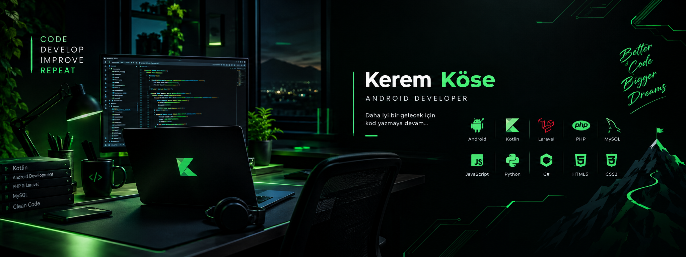
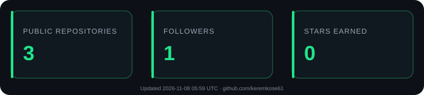

  

---

## Öne Çıkan Projeler

### Soru Bankası
PHP ile geliştirdiğim web tabanlı soru bankası projesi.

[Projeyi incele](https://github.com/keremkose61/soru-bankasi)

### ODİS – Okul Disiplin ve İzleme Sistemi
Okul yönetimi ve öğrenci takibi üzerine geliştirdiğim proje.

[Projeyi incele](https://github.com/keremkose61/OD-S)

---

## GitHub İstatistiklerim

  

Projelerimi, depolarımı ve katkılarımı [GitHub profilimden](https://github.com/keremkose61) inceleyebilirsin.

---

## Şu Anda Öğreniyorum

- Android Development with Kotlin
- Modern Android Architecture
- Backend Development
- Database Management
- Software Engineering

---

## İletişim

  
  

---

  <b>Build. Learn. Improve. Repeat.</b>

